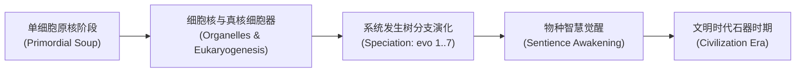
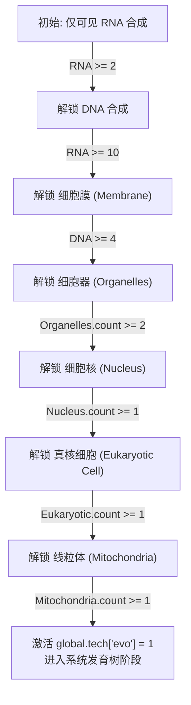
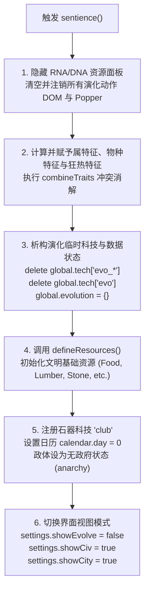

# 演化时代（Evolution Era）底层机制、数学公式与数据状态结构逆向分析

> **Author**: Wayfinder Agent (Reverse Engineering Research)  
> **Source Commit**: `refs/` upstream submodule commit `3436358dcd03d9f9e071d51ea071e0a78c0322e4`  
> **Primary Source Files Cited**:
> - `refs/src/vars.js`
> - `refs/src/main.js`
> - `refs/src/actions.js`
> - `refs/src/functions.js`
> - `refs/src/races.js`
> - `refs/src/resources.js`
> - `refs/src/events.js`
> - `refs/strings/strings.json` / `refs/strings/strings.zh-CN.json`

---

## 1. 概述与生命周期模型 (Overview & Lifecycle)

演化时代（Evolution Era）是 Evolve 游戏周期的开篇阶段。玩家从最初的原生质体（`protoplasm`）单细胞生命起步，经由原始汤中 RNA 与 DNA 的合成、细胞器解锁分化、有性生殖分化，沿着系统发生树（Phylogenetic Tree）经历界、门、纲、目、科、属的阶梯式演化，最终触发智慧觉醒（Sentience Awakening），将种族性状固化并平滑过渡到文明时代（Civilization Era）。

### 1.1 核心阶段划分

演化时代划分为三个核心阶段：



1. **原核细胞与原始汤期 (Primordial Soup)**：
   - 物种身份为 `protoplasm` (`refs/src/vars.js#L2011`)。
   - 手动点击合成 RNA，合成 DNA，按序解锁细胞膜（Membrane）、细胞器（Organelles）、细胞核（Nucleus）、真核细胞（Eukaryotic Cell）与线粒体（Mitochondria）。
2. **系统发育树分支期 (Phylogenetic Speciation)**：
   - 购买线粒体后激活科技 `evo: 1` (`refs/src/main.js#L1282`)。
   - 经历 7 个离散演化阶梯（`final` 进度由 0% 推进至 100%）：有性生殖、营养与运动分型（吞噬/叶绿素/几丁质/合成灭绝）、多细胞化、对称性/孢子/变温吸水、纲目科分化、属级锁定。
3. **智慧觉醒与文明转换期 (Awakening & Era Transition)**：
   - 当 `evo === 7 && final === 100` 时，出现“觉醒”（Sentience）或特定种族演化动作 (`refs/src/actions.js#L869-L927`, `L5160-L5212`)。
   - 触发 `sentience()` 函数 (`refs/src/actions.js#L8343-L8650`)，清空演化专有状态，计算并注入种属及种族性状，初始化文明时代资源与建筑。

---

## 2. 资源池与合成公式 (Resource Pools & Synthesis Formulas)

### 2.1 资源池初始结构

在 `protoplasm` 阶段，游戏仅展示 `RNA` 与 `DNA` 两个演化资源池 (`refs/src/resources.js#L674-L682`, `refs/src/main.js#L775`)：

```javascript
// refs/src/resources.js#L675-L682
if (global.race.species === 'protoplasm'){
    let base = 100;
    if (global.stats.achieve['mass_extinction'] && global.stats.achieve['mass_extinction'].l > 1){
        base += 50 * (global.stats.achieve['mass_extinction'].l - 1);
    }
    loadResource('RNA', wiki, base, 1, false);
    loadResource('DNA', wiki, base, 1, false);
}
```

- **基础容量上限（Base Capacity）**：
  $$\text{Cap}_{\text{base}} = 100 + 50 \times \max(0, \text{Level}(\text{mass\_extinction}) - 1)$$
  *注：若无大灭绝成就（Mass Extinction），基础上限为 100。*

### 2.2 动态容量上限计算公式 (Cap Calculation)

每个中循环（Mid Loop，即每 4 个 Tick / 1000ms），系统动态刷新 RNA 与 DNA 的最大存储上限 (`refs/src/main.js#L8135-L8155`)：

$$\text{Cap}_{\text{RNA}} = \text{Cap}_{\text{base}} + N_{\text{membrane}} \times (N_{\text{mitochondria}} \times 5 + 5)$$

$$\text{Cap}_{\text{DNA}} = \text{Cap}_{\text{base}} + N_{\text{eukaryotic\_cell}} \times (N_{\text{mitochondria}} \times 10 + 10)$$

- $N_{\text{membrane}}$: 已购买细胞膜数量（`global.evolution.membrane.count`）
- $N_{\text{eukaryotic\_cell}}$: 已购买真核细胞数量（`global.evolution.eukaryotic_cell.count`）
- $N_{\text{mitochondria}}$: 已购买线粒体数量（`global.evolution.mitochondria.count`）

**线粒体增益效应**：
- 0 个线粒体时：每个细胞膜提供 $+5$ RNA 容量；每个真核细胞提供 $+10$ DNA 容量。
- 每增加 1 个线粒体：细胞膜单件容量增益增加 $+5$（即 $5 \times (k+1)$）；真核细胞单件容量增益增加 $+10$（即 $10 \times (k+1)$）。

### 2.3 手动合成机制 (Manual Actions)

1. **合成 RNA (`evolution-rna`)** (`refs/src/actions.js#L23-L38`):
   - **条件**：`global.resource.RNA.display && !global.race.evoFinalMenu`
   - **单次点击产出**：
     $$\Delta\text{RNA} = \begin{cases} 2, & \text{若拥有突变性状 } \texttt{rapid\_mutation} \\ 1, & \text{默认} \end{cases}$$
   - **上限约束**：$\text{RNA}_{\text{amount}} < \text{RNA}_{\text{max}}$

2. **合成 DNA (`evolution-dna`)** (`refs/src/actions.js#L39-L54`):
   - **解锁条件**：当 $\text{RNA}_{\text{amount}} \ge 2$ 首次达到时解锁 (`refs/src/main.js#L1252-L1260`)。
   - **消耗**：$2 \text{ RNA}$。
   - **产出**：$+1 \text{ DNA}$。
   - **上限约束**：$\text{DNA}_{\text{amount}} < \text{DNA}_{\text{max}}$。

### 2.4 成本计算模型与常数表 (Cost Scaling & Multipliers)

细胞器成本遵循统一的线性公式 `evolveCosts` (`refs/src/actions.js#L5669-L5672`)：

$$\text{Cost}(N) = N \times \text{Multiplier} + \text{Base}$$

其中 $N$ 为当前已拥有的该细胞器数量（`global.evolution[key].count`）。

#### 细胞器成本矩阵表

| 细胞器键名 (`key`) | 中文名称 | RNA 基础 (`Base`) | RNA 增量 (`Mult`) | DNA 基础 (`Base`) | DNA 增量 (`Mult`) | 代码出处 |
| :--- | :--- | :--- | :--- | :--- | :--- | :--- |
| `membrane` | 细胞膜 | 2 | 2 | — | — | `refs/src/actions.js#L60` |
| `organelles` | 细胞器 | 12 | 8 | 4 | 4 | `refs/src/actions.js#L80-L81` |
| `nucleus` (未达 evo 4) | 细胞核 | 38 | 32 | 18 | 16 | `refs/src/actions.js#L104-L105` |
| `nucleus` ($\text{evo} \ge 4$) | 细胞核 (优化) | 38 | 16 | 18 | 12 | `refs/src/actions.js#L104-L105` |
| `eukaryotic_cell` | 真核细胞 | 20 | 20 | 40 | 12 | `refs/src/actions.js#L125-L126` |
| `mitochondria` | 线粒体 | 75 | 50 | 65 | 35 | `refs/src/actions.js#L147-L148` |

#### CRISPR 减免修正 (`adjustCosts`)
若玩家解锁了 CRISPR 基因 `evolve`（昂贵传承 / Costly Heritage），`adjustCosts` 对所有演化期 RNA 和 DNA 成本统一享受 20% 折扣 (`refs/src/functions.js#L1761-L1769`)：

$$\text{Cost}_{\text{final}} = \lfloor \text{Cost}_{\text{base}} \times 0.8 + 0.5 \rfloor = \text{round}(\text{Cost} \times 0.8)$$

---

## 3. 细胞器解锁链与协同效应 (Organelles System)

### 3.1 解锁条件与触发时机

细胞器的解锁均在主 Tick 循环中实时监控检测 (`refs/src/main.js#L1252-L1285`)：



| 细胞器 | 解锁前置条件 (`refs/src/main.js`) | 核心功能与离散影响 |
| :--- | :--- | :--- |
| **DNA 合成** | $\text{RNA} \ge 2$ (L1252) | 允许将 RNA 转化为 DNA；若拥有 `mass_extinction > 1`，首次解锁直接加满 RNA/DNA 池。 |
| **细胞膜** (`membrane`) | $\text{RNA} \ge 10$ (L1261) | 提升 RNA 上限：每件 $+5 \times (N_{\text{mito}} + 1)$。 |
| **细胞器** (`organelles`) | $\text{DNA} \ge 4$ (L1265) | 自动化生产 RNA：每秒产生 $N_{\text{org}} \times \text{mult}_{\text{rna}}$。 |
| **细胞核** (`nucleus`) | $N_{\text{organelles}} \ge 2$ (L1269) | 自动化将 RNA 转录为 DNA：每秒消耗 $2 \times N_{\text{nuc}}$ RNA，生成 $1 \times N_{\text{nuc}}$ DNA（$\text{evo}\ge 5$ 时翻倍）。 |
| **真核细胞** (`eukaryotic_cell`) | $N_{\text{nucleus}} \ge 1$ (L1273) | 提升 DNA 上限：每件 $+10 \times (N_{\text{mito}} + 1)$。 |
| **线粒体** (`mitochondria`) | $N_{\text{eukaryotic\_cell}} \ge 1$ (L1277) | 双重放大细胞膜与真核细胞的容量收益；首次购买触发 `global.tech['evo'] = 1`。 |

### 3.2 预设强化与跳过机制 (Master/Grandmaster Perks)

游戏记录玩家历史成就并赋予加速跳过能力 (`refs/src/main.js#L776-L816`)：

1. **大师专长 (Master Feat & Ascended)**:
   - 计算：`perk_rank = min(stats.achieve.ascended.l, stats.feat.master)`（模拟环境为 5）。
   - 若 `perk_rank > 0 && !global.evolution.mloaded`：
     - 直接解锁所有 5 种细胞器与 DNA。
     - $N_{\text{membrane}} = \text{perk\_rank} \times 2$
     - $N_{\text{eukaryotic\_cell}} = \text{perk\_rank}$
     - $N_{\text{mitochondria}} = \text{perk\_rank}$
     - $N_{\text{organelles}} = \text{perk\_rank} \times 2$
     - $N_{\text{nucleus}} = \text{perk\_rank} \times 2$
     - 直接赋予 `global.tech['evo'] = 2`，绕过整个单细胞培养期！
2. **宗师专长 (Grandmaster Feat & Corrupted)**:
   - 计算：`grand_rank = min(stats.achieve.corrupted.l, stats.feat.grandmaster)`。
   - 若 `grand_rank >= 5 && !global.evolution.gmloaded`：
     - 设置 `global.evolution.gselect = true`（自由自选属）。
     - 设置 `global.tech.evo = 6`，演化进度 `final = 80`。
     - 预先点亮所有门纲目科技标识，允许跳过所有中间演化直接点选目标属！

---

## 4. 离散 Tick 计算逻辑 (Discrete Tick Loop Engine)

### 4.1 核心时间步参数

游戏底层由工作线程与时间循环驱动 (`refs/src/functions.js#L145-L172`, `refs/src/main.js#L841-L877`)：
- **基础 Tick 周期**：`webWorkerMainTimer = 250ms`（即每秒执行 4 个 Tick）。
- **时间步长乘数**：`time_multiplier = 0.25` (`refs/src/main.js#L1216`)。
  *注：每个 Tick 发生的增量乘以 $0.25$，确保 1 秒内 4 个 Tick 的总产出恰好等于 1 秒的额定标称值。*
- **全局产出乘数** (`global_multiplier`):
  在 `refs/src/main.js#L894-L950` 中计算：
  $$\text{global\_multiplier} = 1 + \text{PlasmidBonus} + \text{AntiPlasmidBonus} + \text{SupercoiledBonus} + \dots$$

### 4.2 演化时代 Tick 执行管道算法

当 `global.race.species === 'protoplasm'` 时，每个 Tick 依序执行如下离散算子 (`refs/src/main.js#L1219-L1285`)：

```mermaid
sequenceDiagram
    participant Loop as Main Tick Loop
    participant Res as Resource Store
    participant Unlock as Unlock Monitor

    Note over Loop: 1. 计算 global_multiplier, time_multiplier = 0.25
    
    alt 细胞核 DNA 自动转录
        Loop->>Res: 检查 RNA 是否满足消耗 (increment * 2)
        Note over Loop: 若不足，自减 increment 直至 RNA >= increment * 2
        Loop->>Res: modRes('RNA', -(increment * 2 * time_multiplier))
        Note over Loop: 若 evo >= 5, 产量翻倍
        Loop->>Res: modRes('DNA', increment * (evo >= 5 ? 2 : 1) * global_multiplier * time_multiplier)
    end

    alt 细胞器 RNA 自动合成
        Note over Loop: rna_multiplier = (rapid_mutation ? 2 : 1) + (evo >= 2 ? 1 : 0)
        Loop->>Res: modRes('RNA', N_org * rna_multiplier * global_multiplier * time_multiplier)
    end

    alt 天启专长 (Apocalypse / Novice Feat)
        Loop->>Res: modRes('RNA', (rank / 2) * time_multiplier * global_multiplier)
        Loop->>Res: modRes('DNA', (rank / 4) * time_multiplier * global_multiplier)
    end

    Note over Loop: 2. 检测新解锁里程碑 (DNA, Membrane, Organelles, Nucleus, etc.)
    Loop->>Unlock: 满足阈值 -> 激活对应 global.evolution 键并重绘
```

#### 伪代码实现规范 (Kotlin Engine 参考)

```kotlin
fun evaluateEvolutionTick(state: GameState, dt: Double = 0.25) {
    if (state.race.species != "protoplasm") return

    val globalMultiplier = state.calculateGlobalMultiplier()
    
    // 1. 细胞核转录 (Nucleus RNA -> DNA)
    val nucleusCount = state.evolution["nucleus"]?.count ?: 0
    if (nucleusCount > 0 && state.resources["DNA"].amount < state.resources["DNA"].max) {
        var increment = nucleusCount
        while (state.resources["RNA"].amount < increment * 2 && increment > 0) {
            increment--
        }
        if (increment > 0) {
            val dnaOutputMultiplier = if ((state.tech["evo"] ?: 0) >= 5) 2.0 else 1.0
            val dnaGain = increment * dnaOutputMultiplier * globalMultiplier * dt
            val rnaCost = increment * 2.0 * dt
            
            state.resources.modify("DNA", dnaGain)
            state.resources.modify("RNA", -rnaCost)
        }
    }

    // 2. 细胞器生产 RNA (Organelles)
    val organellesCount = state.evolution["organelles"]?.count ?: 0
    if (organellesCount > 0) {
        var rnaMultiplier = if (state.race.hasTrait("rapid_mutation")) 2.0 else 1.0
        if ((state.tech["evo"] ?: 0) >= 2) {
            rnaMultiplier += 1.0
        }
        val rnaGain = organellesCount * rnaMultiplier * globalMultiplier * dt
        state.resources.modify("RNA", rnaGain)
    }

    // 3. 历史专长被动补给 (Apocalypse / Novice Perk)
    val apocalypseRank = state.stats.getApocalypsePerkRank()
    if (apocalypseRank > 0) {
        state.resources.modify("RNA", (apocalypseRank / 2.0) * dt * globalMultiplier)
        if (state.resources["DNA"].isUnlocked) {
            state.resources.modify("DNA", (apocalypseRank / 4.0) * dt * globalMultiplier)
        }
    }

    // 4. 状态机阈值检测 (Threshold Trigger Checks)
    checkEvolutionUnlocks(state)
}
```

### 4.3 演化时代随机事件 (`refs/src/events.js#L13-L41`)

在原生质体阶段，事件引擎每隔一定周期触发以下专属 Major 事件：
1. **DNA 复制 (`dna_replication`)**:
   - 触发前置：`race === 'protoplasm' && resource.DNA.display`
   - 效果：获得 $\text{rand}(1, \lfloor \text{DNA}_{\text{max}} / 3 \rfloor)$ DNA。
2. **RNA 陨石富集 (`rna_meteor`)**:
   - 触发前置：`race === 'protoplasm' && resource.RNA.display`
   - 效果：获得 $\text{rand}(1, \lfloor \text{RNA}_{\text{max}} / 2 \rfloor)$ RNA。

---

## 5. 演化树阶段推进与分类阶梯 (Phylogenetic Tree)

演化时代完整遵循现代生物分类学阶元：**域 (Domain) $\to$ 界/门 (Phylum) $\to$ 纲 (Class) $\to$ 目 (Order) $\to$ 科 (Family) $\to$ 属 (Genus) $\to$ 种 (Species)**。

### 5.1 阶梯推进状态矩阵表

| 阶段等级 | 阶元类型 | 演化选项键名 | 选项名称 | DNA 消耗 | 前置条件 (`reqs` / `condition`) | 赋予状态 (`grant`) | 进度 (`final`) | 代码行号 (`refs/src/actions.js`) |
| :--- | :--- | :--- | :--- | :--- | :--- | :--- | :--- | :--- |
| **Stage 1** | **生命起点** | `sexual_reproduction` | 有性生殖 | 150 | `evo: 1` | `evo = 2` | 20% | L159-L178 |
| **Stage 2** | **域/界分化** | `phagocytosis` | 吞噬作用 (动物界) | 175 | `evo: 2` | `evo = 3`, `evo_animal = 1` | 40% | L179-L199 |
| | | `chloroplasts` | 叶绿体 (植物界) | 175 | `evo: 2` | `evo = 3`, `evo_plant = 1` | 40% | L200-L228 |
| | | `chitin` | 几丁质 (真菌界) | 175 | `evo: 2` | `evo = 3`, `evo_fungi = 1` | 40% | L229-L257 |
| | | `exterminate` | 机械清除 (合成界) | 200 | `evo: 2`, `obsolete >= 5` | `evo = 7`, `evo_synthetic = 2` | 100% | L258-L281 |
| **Stage 3** | **组织分化** | `multicellular` | 多细胞化 | 200 | `evo: 3` | `evo = 4` | 60% | L282-L301 |
| **Stage 4** | **门级分化** | `poikilohydric` | 变水植物 (植物) | 230 | `evo: 4`, `evo_plant: 1` | `evo = 5` | 80% | L322-L341 |
| | | `spores` | 孢子形成 (真菌) | 230 | `evo: 4`, `evo_fungi: 1` | `evo = 5` | 80% | L302-L321 |
| | | `bilateral_symmetry`| 两侧对称 (动物) | 230 | `evo: 4`, `evo_animal: 1` | `evo = 5`, 解锁哺乳/卵壳/环境分支 | 80% | L342-L370 |
| **Stage 5** | **纲/目分化** | `bryophyte` | 苔藓植物 (植/菌) | 260 | `evo: 5`, `evo_plant/fungi` | `evo = 7`, `evo_plant/fungi = 2` | 100% | L371-L399 |
| | | `athropods` | 节肢动物 (虫族) | 260 | `evo: 5`, `evo_insectoid: 1`| `evo = 7`, `evo_insectoid = 2` | 100% | L400-L421 |
| | | `mammals` | 哺乳动物纲 | 245 | `evo: 5`, `evo_mammals: 1` | `evo = 6`, 解锁人/巨/矮/兽/魔/天 | 90% | L422-L447 |
| | | `eggshell` | 卵生纲 | 245 | `evo: 5`, `evo_eggshell: 1`| `evo = 6`, `evo_eggshell = 2` | 90% | L804-L824 |
| | *(环境分支)* | `aquatic` | 水生纲 (海洋/沼泽) | 260 | `evo: 5`, 生物群系限制 | `evo = 7`, `evo_aquatic = 2` | 100% | L679-L703 |
| | *(环境分支)* | `fey` | 妖精纲 (森林/沼泽) | 260 | `evo: 5`, 生物群系限制 | `evo = 7`, `evo_fey = 2` | 100% | L704-L728 |
| | *(环境分支)* | `heat` | 炽热纲 (火山/灰烬) | 260 | `evo: 5`, 生物群系限制 | `evo = 7`, `evo_heat = 2` | 100% | L729-L753 |
| | *(环境分支)* | `polar` | 极地纲 (苔原/针叶) | 260 | `evo: 5`, 生物群系限制 | `evo = 7`, `evo_polar = 2` | 100% | L754-L778 |
| | *(环境分支)* | `sand` | 沙漠纲 (沙漠/灰烬) | 260 | `evo: 5`, 生物群系限制 | `evo = 7`, `evo_sand = 2` | 100% | L779-L803 |
| | *(特殊分支)* | `eldritch` | 古神纲 | 260 | `evo: 5`, 成就 `nightmare.mg`| `evo = 7`, `evo_eldritch = 2` | 100% | L654-L678 |
| **Stage 6** | **目/科分化** | `humanoid` | 类人目 | 260 | `evo: 6`, `evo_humanoid: 1` | `evo = 7`, `evo_humanoid = 2` | 100% | L448-L469 |
| | | `gigantism` | 巨人目 | 260 | `evo: 6`, `evo_giant: 1` | `evo = 7`, `evo_giant = 2` | 100% | L470-L491 |
| | | `dwarfism` | 矮人目 | 260 | `evo: 6`, `evo_small: 1` | `evo = 7`, `evo_small = 2` | 100% | L492-L513 |
| | | `celestial` | 天界目 (伊甸/无拘) | 260 | `evo: 6`, `biome === 'eden'` | `evo = 7`, `evo_angelic = 2` | 100% | L604-L628 |
| | | `demonic` | 深渊目 (地狱/无拘) | 260 | `evo: 6`, `biome === 'hellscape'`| `evo = 7`, `evo_demonic = 2` | 100% | L629-L653 |
| | | `endothermic` | 恒温目 (鸟纲/Avian) | 260 | `evo: 6`, `evo_eggshell: 2` | `evo = 7`, `evo_avian = 2` | 100% | L825-L846 |
| | | `ectothermic` | 变温目 (爬行纲/Reptilian)| 260 | `evo: 6`, `evo_eggshell: 2` | `evo = 7`, `evo_reptilian = 2` | 100% | L847-L868 |
| | | `animalism` | 兽目 (兽性化过渡) | 250 | `evo: 6`, `evo_animalism: 1`| `evo_animalism = 2` | 95% | L514-L534 |
| **Stage 7** | **科级分化** | `carnivore` | 食肉科 | 255 | `evo_animalism: 2` | `evo = 7`, `evo_carnivore = 2` | 100% | L535-L557 |
| | | `herbivore` | 食草科 | 255 | `evo_animalism: 2` | `evo = 7`, `evo_herbivore = 2` | 100% | L558-L580 |
| | | `omnivore` | 杂食科 | 255 | `evo_animalism: 2`, `locked` | `evo = 7`, `evo_omnivore = 2` | 100% | L581-L603 |

### 5.2 生态群系与环境适应限制 (Environmental Restrictions)

特定属的分支对行星当前生态群系（`global.city.biome`）有严苛约束 (`refs/src/actions.js#L611-L788`)：

1. **水生 (`aquatic`)**：必须满足 `['oceanic', 'swamp'].includes(biome)` 或 CRISPR 血清注药 `unbound >= 1`。
2. **妖精 (`fey`)**：必须满足 `['forest', 'swamp', 'taiga'].includes(biome)` 或 `unbound >= 1`。
3. **炽热 (`heat`)**：必须满足 `['volcanic', 'ashland'].includes(biome)` 或 `unbound >= 1`。
4. **极地 (`polar`)**：必须满足 `['tundra', 'taiga'].includes(biome)` 或 `unbound >= 1`。
5. **沙漠 (`sand`)**：必须满足 `['desert', 'ashland'].includes(biome)` 或 `unbound >= 1`。
6. **天界 (`angelic`)**：必须满足 `biome === 'eden'` 或 `unbound >= 3`。
7. **恶魔 (`demonic`)**：必须满足 `biome === 'hellscape'` 或 `unbound >= 3`。
8. **炼狱警告 (`hellscape`)**：
   在非邪恶宇宙（`evil`）中若星球为 `hellscape`，选择绝大多数凡间种族均会弹出严重警告 (`evo_warn_unwise`：“此地极度严酷，缺乏有机食物，非恶魔生命降临后将面临即刻绝灭”)。

---

## 6. 属与物种分类学全谱 (Taxonomy: Genus & Species)

系统包含 **20 个独立属（Genus）**，定义于 `refs/src/races.js#L85-L238`。智慧觉醒时，该属的固定特征将注入种族。

### 6.1 属级特征与物种对应全览表

| 属键名 (`genus`) | 属中文名 | 属自带性状 (`genus_def.traits`) | 对立属 (`oppose`) | 对应原生演化种族 (`raceList`) |
| :--- | :--- | :--- | :--- | :--- |
| `humanoid` | 类人属 | `adaptable: 1` (适应), `wasteful: 1` (浪费) | `fungi` | `human` (人类), `elven` (精灵), `orc` (兽人) |
| `giant` | 巨人属 | `large: 1` (巨大), `strong: 1` (强壮) | `small` | `troll` (巨魔), `ogre` (食人魔), `cyclops` (独眼巨人) |
| `small` | 小型属 | `small: 1` (矮小), `weak: 1` (虚弱) | `giant` | `kobold` (狗头人), `goblin` (地精), `gnome` (侏儒) |
| `carnivore` | 食肉属 | `carnivore: 1` (肉食), `beast: 1` (野兽), `cautious: 1` (谨慎) | `herbivore` | `cath` (猫族), `wolven` (狼族), `vulpine` (狐族) |
| `herbivore` | 食草属 | `herbivore: 1` (草食), `instinct: 1` (直觉) | `carnivore` | `centaur` (半人马), `rhinotaur` (犀牛人), `capybara` (水豚) |
| `omnivore` | 杂食属 | `forager: 1` (杂食采集), `beast: 1`, `cautious: 1`, `instinct: 1` | — | `porkenari` (猪人), `hedgeoken` (刺猬人) |
| `reptilian` | 爬行属 | `cold_blooded: 1` (冷血), `scales: 1` (鳞片) | `avian` | `tortoisan` (龟族), `gecko` (壁虎), `slitheryn` (蛇族) |
| `avian` | 鸟属 | `flier: 1` (飞行), `hollow_bones: 1` (空心骨), `sky_lover: 1` (天空热爱) | `reptilian` | `arraak` (阿拉克鸟人), `pterodacti` (翼龙人), `dracnid` (天龙人) |
| `plant` | 植物属 | `sappy: 1` (多汁), `asymmetrical: 1` (非对称) | `insectoid` | `entish` (树人), `cacti` (仙人掌), `pinguicula` (捕虫堇) |
| `fungi` | 真菌属 | `detritivore: 1` (食腐), `spongy: 1` (海绵质) | `humanoid` | `sporgar` (孢子人), `shroomi` (蘑菇人), `moldling` (霉菌人) |
| `insectoid` | 昆虫属 | `high_pop: 1` (高人口), `fast_growth: 1` (快速繁衍), `high_metabolism: 1` | `plant` | `mantis` (螳螂), `scorpid` (蝎族), `antid` (蚁族) |
| `aquatic` | 水生属 | `submerged: 1` (水生), `low_light: 1` (微光适应) | `sand` | `sharkin` (鲨鱼人), `octigoran` (章鱼人) |
| `fey` | 妖精属 | `elusive: 1` (隐匿), `iron_allergy: 1` (冷铁过敏) | `eldritch`, `synthetic` | `dryad` (树精), `satyr` (萨提尔) |
| `heat` | 炽热属 | `smoldering: 1` (闷燃), `cold_intolerance: 1` (畏寒) | `polar` | `phoenix` (凤凰), `salamander` (火蜥蜴) |
| `polar` | 极地属 | `chilled: 1` (耐寒), `heat_intolerance: 1` (不耐热) | `heat` | `yeti` (雪人), `wendigo` (温迪戈) |
| `sand` | 沙漠属 | `scavenger: 1` (拾荒), `nomadic: 1` (游牧) | `aquatic` | `tuskin` (獠牙人), `kamel` (骆驼人) |
| `demonic` | 恶魔属 | `immoral: 1` (不道德), `evil: 1` (邪恶), `soul_eater: 1` (噬魂) | `angelic` | `imp` (小鬼), `balorg` (巴洛炎魔), `hellspawn` (地狱造物) |
| `angelic` | 天使属 | `blissful: 1` (极乐), `pompous: 1` (自大), `holy: 1` (神圣) | `demonic` | `seraph` (炽天使), `unicorn` (独角兽) |
| `synthetic` | 合成属 | `artifical: 1` (人造机械), `powered: 1` (供能驱动) | `eldritch`, `fey` | `synth` (合成人), `nano` (纳米集群) |
| `eldritch` | 古神属 | `psychic: 1` (灵能), `tormented: 1` (折磨), `darkness: 1`, `unfathomable: 1` | `synthetic`, `fey` | `ghast` (尸鬼), `shoggoth` (修格斯) |

### 6.2 混种融合机制 (Hybrid Species)

当解锁 `godslayer`（弑神者）成就后，游戏允许演化出由两个对立或跨界母属杂交生成的混种生物（Hybrid）：

| 混种物种 (`species`) | 中文名称 | 母属组合 (`hybrid`) | 独有狂热性状 (`fanaticism`) | 固有种族性状 (`traits`) |
| :--- | :--- | :--- | :--- | :--- |
| `dwarf` | 矮人 | `humanoid` + `small` | `artisan` (工匠) | `stubborn: 1` (顽固) |
| `raccoon` | 浣熊人 | `carnivore` + `herbivore` | `rogue` (游侠/盗贼) | `untrustworthy: 1` (不可靠) |
| `lichen` | 地衣人 | `plant` + `fungi` | `living_materials` (活体材料) | `unstable: 1` (不稳定) |
| `wyvern` | 飞龙 | `avian` + `reptilian` | `elemental` (元素吐息) | `chicken: 1` (怯懦胆小) |
| `beholder` | 眼魔 | `eldritch` + `giant` | `ocular_power` (魔眼权能) | `floating: 1` (悬浮漂浮) |
| `djinn` | 神灯精灵 | `sand` + `fey` | `wish` (神灯祈愿) | `devious: 1` (狡黠奸诈) |
| `narwhal` | 独角鲸人 | `aquatic` + `polar` | `tusk` (巨齿长矛) | `blubber: 1` (厚实鲸脂) |
| `bombardier` | 气步甲人 | `insectoid` + `heat` | `grenadier` (掷弹专家) | `aggressive: 1` (侵略好战) |
| `nephilim` | 奈非天 | `demonic` + `angelic` | `empowered` (神魔充能) | `blasphemous: 1` (亵渎无光) |

---

## 7. 基因突变性状与阶梯合并机制 (Traits & Mutation System)

### 7.1 性状阶位阶梯 (Rank Ladder)

性状阶梯在 `refs/src/races.js#L7759-L7784` 中由 `setTraitRank` 函数严格离散控制：

$$\text{Ladder}: \quad 0.1 \longleftrightarrow 0.25 \longleftrightarrow 0.5 \longleftrightarrow 1.0 \longleftrightarrow 2.0 \longleftrightarrow 3.0 \longleftrightarrow 4.0$$

- **晋升升级 (`setTraitRank(trait)`)**：沿梯子向上位阶跃升（最高至 4.0）。
- **降级惩罚 (`setTraitRank(trait, {down: true})`)**：沿梯子向下位阶降级（最低至 0.1）。

### 7.2 觉醒时主属与次属性状结算逻辑 (`refs/src/actions.js#L8391-L8407`)

在智慧觉醒时：
1. **主特化属（Main-spec）判定**：
   若该属科技 `global.tech['evo_' + genus] >= 2`：
   - 确立为 `global.race.maintype = genus`。
   - 该属固有性状以基准阶位（通常为 1.0）注入。
   - **探路者专长补正**：若成就 `pathfinder >= 4`，该主属性状自动无偿晋升一级（例如 $1.0 \to 2.0$）。
2. **次属（Off-spec，混种的第二母属）**：
   - 该属性状注入时强制降级一级（例如 $1.0 \xrightarrow{\text{down}} 0.5$）。
3. **物种专属特征注入**：
   - `races[species].traits` 中定义的物种特征按其标称值覆盖赋予（例如人类的 `creative: 1`, `diverse: 1`）。
4. **互斥特征融合消除 (`combineTraits`)** (`refs/src/races.js#L7707-L7732`)：
   - 若种族同时拥有 `herbivore` 与 `carnivore`：
     - 系统将两项性状移入 `inactiveTraits`。
     - 自动激活并赋予通用杂食采集特征 `forager: 1`。

### 7.3 演化挑战注入机制 (`refs/src/actions.js#L5250-L5360`, `L8508-L8536`)

当解锁 CRISPR 地下掩体（Bunker）后，演化期可额外注入挑战基因：
- **`badgenes`（劣质基因）/ `no_crispr`**：
  觉醒瞬间触发负面基因轮盘（`neg_roll_traits`），随机抽取 1 至 3 个致残性状（如 `dumb`, `weak`, `clumsy` 等）强制加入基因组。
- **环境挑战性状**：
  如 `orbit_decay`（轨道衰减 5000 天碰撞倒计时）、`gravity_well`（超重力世界增加质量消耗）。

---

## 8. 智慧觉醒与文明时代转换 (Sentience & Era Transition)

### 8.1 觉醒触发条件与成本

1. **觉醒门槛**：
   - 演化科技等级：`global.tech.evo === 7`
   - 演化总进度：`global.evolution.final === 100`

2. **觉醒模式对比**：
   - **随机觉醒 (`actions.evolution.sentience`)** (`refs/src/actions.js#L869-L927`):
     - **消耗**：$300 \text{ RNA}, 300 \text{ DNA}$。
     - **机制**：从已解锁的主属对应种族列表中，伪随机种子抽取一个物种：
       `allowed[Math.floor(seededRandom(0, allowed.length))]`
       （若抽取的种族已经灭绝过，系统再执行一次重抽补偿）。
   - **定点靶向演化 (`actions.evolution[race]`)** (`refs/src/actions.js#L5160-L5212`):
     - **解锁前置**：玩家拥有种子星球开局、或者大灭绝成就 `mass_extinction >= 1`、或者该物种专属绝灭成就 `extinct_<race> >= 1`。
     - **消耗**：$320 \text{ RNA}, 320 \text{ DNA}$。
     - **机制**：玩家直接点击指定种族卡片进化，确立 `global.race.species = race`。

### 8.2 转换流水线核心逻辑 (`function sentience()`)

`refs/src/actions.js#L8343-L8650` 定义了从单细胞到文明社会的完整析构与建构流程：



#### 转换现场状态变更清单：

1. **面板与资源隐藏** (`refs/src/actions.js#L8354-L8359`):
   - `global.resource.RNA.display = false`
   - `global.resource.DNA.display = false`
2. **状态机重置** (`refs/src/actions.js#L8426-L8433`):
   - 遍历 `global.tech`，删除所有以 `evo_` 开头的临时键；
   - 删除 `global.tech['evo']`；
   - 彻底置空 `global.evolution = {}`。
3. **文明资源与生产初值初始化** (`refs/src/actions.js#L8567-L8592`):
   - 清理演化 DOM，调用 `defineResources()`；
   - 木柴（Lumber）与石头（Stone）依照是否包含闷燃/易燃性状自适应点亮；
   - 注册第一项文明科技 `registerTech('club')`（石器时代大棒）；
   - 初始化城市日历 `global.city.calendar.day = 0`。
4. **政体与视图切换** (`refs/src/actions.js#L8637-L8645`):
   - `global.settings.showEvolve = false`（永久隐藏演化标签页）
   - `global.settings.showCiv = true`，`global.settings.showCity = true`
   - 初始政体确立：`global.civic.govern.type = 'anarchy'`（无政府状态）

---

## 9. Kotlin 领域模型建模建议 (Domain Engine Architecture)

基于上述逆向公式与状态转移规则，建议在 Android/KMP 领域模型中采用清晰解耦的不可变数据模型与纯函数算子。

### 9.1 领域实体建模推荐

```kotlin
package com.yrsb.evolve.domain.model.evolution

import kotlinx.serialization.Serializable

/**
 * 演化资源池状态
 */
@Serializable
data class EvolutionResourcePool(
    val rna: Double = 0.0,
    val rnaMax: Double = 100.0,
    val dna: Double = 0.0,
    val dnaMax: Double = 100.0,
    val isDnaUnlocked: Boolean = false
)

/**
 * 细胞器状态
 */
@Serializable
data class OrganelleState(
    val membraneCount: Int = 0,
    val organellesCount: Int = 0,
    val nucleusCount: Int = 0,
    val eukaryoticCellCount: Int = 0,
    val mitochondriaCount: Int = 0
) {
    fun calculateRnaCap(baseCap: Double): Double =
        baseCap + membraneCount * (mitochondriaCount * 5.0 + 5.0)

    fun calculateDnaCap(baseCap: Double): Double =
        baseCap + eukaryoticCellCount * (mitochondriaCount * 10.0 + 10.0)
}

/**
 * 分类学枚举体系
 */
enum class TaxonomicStage(val level: Int, val targetProgress: Int) {
    PROTOPLASM(0, 0),
    SEXUAL_REPRODUCTION(1, 20),
    KINGDOM_DIVERGENCE(2, 40),
    MULTICELLULAR(3, 60),
    PHYLUM_SYMMETRY(4, 80),
    CLASS_ORDER_BRANCH(5, 90),
    GENUS_SELECTION(6, 100),
    SENTIENCE_AWAKENING(7, 100)
}

enum class Genus(val id: String, val oppose: List<String>) {
    HUMANOID("humanoid", listOf("fungi")),
    GIANT("giant", listOf("small")),
    SMALL("small", listOf("giant")),
    CARNIVORE("carnivore", listOf("herbivore")),
    HERBIVORE("herbivore", listOf("carnivore")),
    OMNIVORE("omnivore", emptyList()),
    REPTILIAN("reptilian", listOf("avian")),
    AVIAN("avian", listOf("reptilian")),
    PLANT("plant", listOf("insectoid")),
    FUNGI("fungi", listOf("humanoid")),
    INSECTOID("insectoid", listOf("plant")),
    AQUATIC("aquatic", listOf("sand")),
    FEY("fey", listOf("eldritch", "synthetic")),
    HEAT("heat", listOf("polar")),
    POLAR("polar", listOf("heat")),
    SAND("sand", listOf("aquatic")),
    DEMONIC("demonic", listOf("angelic")),
    ANGELIC("angelic", listOf("demonic")),
    SYNTHETIC("synthetic", listOf("eldritch", "fey")),
    ELDRITCH("eldritch", listOf("synthetic", "fey")),
    HYBRID("hybrid", emptyList())
}
```

### 9.2 状态转移纯函数设计

- **`evolveOrganelle(state, organelleType)`**: 线性计算扣除 RNA/DNA，递增数量，重新计算 Upper Cap。
- **`stepEvolutionTick(state, dt)`**: 执行转录与合成，校验解锁阈值。
- **`awakenSentience(state, targetSpecies)`**: 转换流水线，输出 `CivilizationEraState`。

---

## 10. 逆向工程比对总结 (Verification Checklist)

| 核心诉求项 | 规范对应章节 | 代码溯源行号 | 验证结论 |
| :--- | :--- | :--- | :--- |
| **RNA/DNA 合成公式与上限** | 第 2 节 | `vars.js#L2011`, `resources.js#L675`, `main.js#L8135` | 基础 100，线粒体线性阶梯放大乘数 |
| **细胞器解锁与作用** | 第 3 节 | `actions.js#L23-L158`, `main.js#L1252-L1285` | 严格依赖资源量及前置细胞器数量门槛 |
| **演化树阶段 (界门纲目科属种)** | 第 5、6 节 | `actions.js#L159-L868`, `races.js#L85-L238` | 7 阶递进推进，20 属 62 种族，9 对混种 |
| **基因性状与突变计算** | 第 7 节 | `races.js#L7759`, `actions.js#L8391` | 0.1~4.0 阶梯跃迁，探路者晋升，对立消除 |
| **智慧觉醒与文明转换** | 第 8 节 | `actions.js#L8343-L8650` | 彻底销毁演化科技状态，平滑过渡至石器时代 |
| **离散 Tick 运算流水线** | 第 4 节 | `main.js#L841-L950`, `L1216-L1285` | 250ms 单步，RNA 约束下向下截断自适应消耗 |
