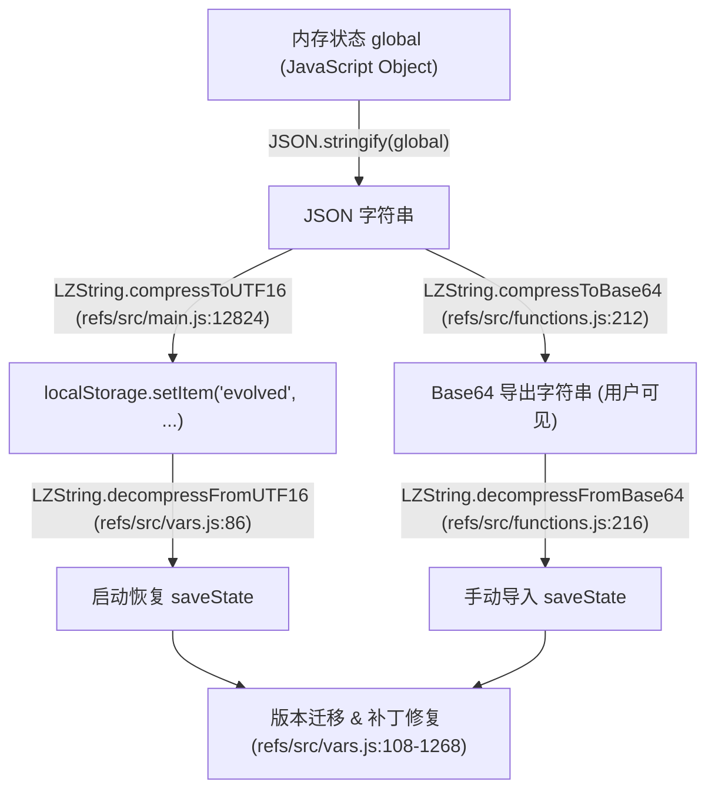

# Web 版 Evolve 存档结构与序列化机制分析规范 (Save Format & Kotlin Parser Spec)

> **文档标识**: `WAYFINDER-RESEARCH-003`  
> **关联 Issue**: [YRSB/Evolve#3](https://github.com/YRSB/Evolve/issues/3)  
> **上游源码基准**: commit `3436358dcd03d9f9e071d51ea071e0a78c0322e4` (v1.4.10)  
> **主要源码引用**:
> - `refs/save.html`
> - `refs/src/main.js`
> - `refs/src/vars.js`
> - `refs/src/functions.js`
> - `refs/src/actions.js`
> - `refs/lib/lz-string.min.js`

---

## 1. 概述与核心结论

Web 版 Evolve 的存档系统基于 **内存全局单例对象 (`global`) -> JSON 字符串 -> LZ-String 压缩编码 -> 持久化/导出** 的流水线。

核心发现如下：
1. **压缩编码方案**:
   - **浏览器内部存储 (`localStorage.getItem('evolved')`)**: 使用 `LZString.compressToUTF16` 压缩为紧凑的 UTF-16 字符串（带 +32 偏移量以规避控制字符）。
   - **导入/导出存档字符串 (`exportGame` / `importGame` / `save.html`)**: 使用 `LZString.compressToBase64` / `decompressFromBase64`。
   - **关键算法特性**: 该 Base64 不是标准 Base64 算法对二进制 byte[] 的编码，而是 **LZW 压缩过程中直接按照 6-bit 字典符号索引映射到自定义 65 字符字母表 (`[A-Za-z0-9+/=]`)**。
2. **存档校验基准 (Sanity Check)**:
   - Web 版导入时在 `refs/src/functions.js:217` 执行硬校验：
     必须同时满足 `evolution in saveState`, `settings in saveState`, `stats in saveState`, 以及 `'plasmid' in saveState.stats`。
3. **架构解耦策略**:
   - 演化时代 (Evolution Era) 与古典早期文明时代 (Early Civilization Era) 仅需反序列化约 8 个核心模块 (`version`, `seed`, `resource`, `evolution`, `race`, `tech`, `city`, `civic`, `stats`)。
   - 中后期庞大模块（如深空 `space`、星际 `interstellar`、银河 `galaxy`、地狱传送门 `portal`、极乐境 `eden`、巨构工程 `arpa`、太空船坞 `starDock` 等）可作为保留字段 (`JsonObject` / 未解析原始载荷) 原样保存，实现无损导入导出。
4. **Kotlin 实现选型**:
   - 推荐在 Kotlin Multiplatform (KMP) 中实现约 80 行的 **自包含纯 Kotlin LZ-String 解码器**，完全零第三方外部依赖，杜绝跨平台 JNI 或 JVM 特定库兼容问题。

---

## 2. 存档压缩与编码机制深入剖析

### 2.1 数据流转流水线

Evolve 的存档流转由以下代码路径驱动：



1. **导出函数 (`window.exportGame`)**:
   - 源码位置: `refs/src/functions.js:207-213`
   ```javascript
   window.exportGame = function exportGame(){
       if (global.race['noexport']){
           return `Export is not available during ${global.race['noexport']} Creation`;
       }
       addATime(Date.now());
       return LZString.compressToBase64(JSON.stringify(global));
   }
   ```
2. **导入函数 (`window.importGame`)**:
   - 源码位置: `refs/src/functions.js:215-257`
   ```javascript
   window.importGame = function importGame(data,utf16){
       let saveState = JSON.parse(utf16 ? LZString.decompressFromUTF16(data) : LZString.decompressFromBase64(data));
       if (saveState && 'evolution' in saveState && 'settings' in saveState && 'stats' in saveState && 'plasmid' in saveState.stats){
           // ... 执行特定 tech 修复与消息颜色属性净化 ...
           save.setItem('evolved',LZString.compressToUTF16(JSON.stringify(saveState)));
           window.location.reload();
       }
   }
   ```
3. **周期性自动存档**:
   - 源码位置: `refs/src/main.js:12821-12825`
   ```javascript
   global.stats['current'] = currentTimestamp;
   if (!global.race.hasOwnProperty('geck')){
       save.setItem('evolved',LZString.compressToUTF16(JSON.stringify(global)));
   }
   ```
4. **独立导出页面 (`refs/save.html`)**:
   - 源码位置: `refs/save.html:18-23`
   ```javascript
   let global_data = window.localStorage.getItem('evolved') || false;
   if (global_data) {
       let saveState = JSON.parse(LZString.decompressFromUTF16(global_data));
       if (saveState){
           document.getElementById('save').innerHTML = LZString.compressToBase64(JSON.stringify(saveState));
       }
   }
   ```

### 2.2 LZString 的内部算法机制 (`refs/lib/lz-string.min.js`)

`lz-string` 是由 Pierrick Gourlain 开发的专用字符串压缩算法，具有特殊的位打包设计：

1. **字典初始化与控制字**:
   - 字典预填 `[0, 1, 2]`，分别代表：
     - `0`: 紧接着读入 8-bit 的原始字符（`charCode < 256`）。
     - `1`: 紧接着读入 16-bit 的原始字符（`charCode >= 256`）。
     - `2`: **流结束标志 (End Of Stream, EOS)**。
2. **动态位宽递增**:
   - 初始位宽 `numBits = 2`，可寻址 0..3。
   - 当字典扩充至当前容量上限时（`enlargeIn == 0`），位宽自增 1 位，容量翻倍（`enlargeIn = 1 << numBits; numBits++`）。
3. **Base64 自定义打包细节**:
   - 字母表: `ABCDEFGHIJKLMNOPQRSTUVWXYZabcdefghijklmnopqrstuvwxyz0123456789+/=`（共 65 字符，第 64 位为 `=`）。
   - **每个 Base64 字符承载 6 bits**。
   - `resetValue = 32`（即二进制最高有效位 `0b100000`）。
   - **位提取方向**:
     - 在单个 6-bit 字符内部，位从最高位向最低位移出（`position >>= 1`）。
     - 在跨位重组的多位数字中，位按低有效位到高有效位（LSB -> MSB）累加（`bits |= bit * power; power <<= 1`）。
   - **填充规整**:
     - 压缩末尾将未满 6-bit 的缓存左移补零后输出。
     - 输出字符串根据 `length % 4` 追加 `=`、`==` 或 `===`。

---

## 3. 全局状态对象 (`global`) 顶级 Schema

完整的 Evolve 存档根结构包含以下主要模块（按逻辑分类）：

| 字段名 | 类型 | 演化/早期文明是否必须 | 说明 | 源码引用 |
| :--- | :--- | :---: | :--- | :--- |
| `version` | `string` | **必须** | 语义化版本号，如 `"1.4.10"` | `refs/src/vars.js:1272` |
| `seed` | `number` | **必须** | 通用随机数种子 (0..10000) | `refs/src/vars.js:71-80` |
| `warseed` | `number` | **必须** | 战斗/战争随机数种子 | `refs/src/vars.js:71-80` |
| `new` | `boolean` | **必须** | 新周目/初始标记 | `refs/src/vars.js:2014` |
| `resource` | `object` | **必须** | 资源字典（DNA/RNA、食物、木材、人口等） | `refs/src/resources.js` |
| `evolution` | `object` | **必须 (演化期)** | 演化期细胞器/突变状态字典 | `refs/src/actions.js:59-220` |
| `race` | `object` | **必须** | 物种名、属分类、基因特质、神明信奉 | `refs/src/races.js` |
| `tech` | `object` | **必须** | 科技树研发字典 (`tech_id -> level`) | `refs/src/tech.js` |
| `city` | `object` | **必须 (文明期)** | 地表建筑、气候、日历、士气 | `refs/src/vars.js:2241-2254` |
| `civic` | `object` | **必须 (文明期)** | 岗位职业人口、政体、税率、邻国外交 | `refs/src/civics.js` |
| `stats` | `object` | **必须** | 游戏统计（天数、质粒数、成就字典等） | `refs/src/vars.js:18-22` |
| `settings` | `object` | **必须** | 游戏 UI 设置、各区域折叠/展开标志 | `refs/src/vars.js:2285-2333` |
| `queue` | `object` | 可选/空对象 | 建筑自动化队列 | `refs/src/vars.js:1366` |
| `r_queue` | `object` | 可选/空对象 | 科技自动化队列 | `refs/src/vars.js:1373` |
| `lastMsg` | `object` | 可选/保留 | 日志消息队列 (`{ all: [], ... }`) | `refs/src/vars.js:1400` |
| `prestige` | `object` | 必须保持结构 | 转生声望资源（质粒、噬菌体等） | `refs/src/vars.js:1276-1283` |
| `genes` | `object` | 早期可默认空 | CRISPR 基因改造点数与特性 | `refs/src/vars.js:16` |
| `blood` | `object` | 早期可默认空 | 血石/恶魔献祭系统 | `refs/src/vars.js:17` |
| `space` | `object` | 晚期 (可保留) | 太阳系开发（月球、火星等建筑） | `refs/src/space.js` |
| `interstellar` | `object` | 晚期 (可保留) | 恒星际航行与深空天体开发 | `refs/src/space.js` |
| `galaxy` | `object` | 晚期 (可保留) | 银河星门与外星文明关系 | `refs/src/space.js` |
| `portal` | `object` | 晚期 (可保留) | 地狱维度要塞与恶魔战斗 | `refs/src/portal.js` |
| `eden` | `object` | 晚期 (可保留) | 天使极乐境与灵魂系统 | `refs/src/edenic.js` |
| `tauceti` | `object` | 晚期 (可保留) | 鲸鱼座 Tau Ceti 殖民星系 | `refs/src/truepath.js` |
| `arpa` | `object` | 晚期 (可保留) | A.R.P.A. 巨构工程研发 | `refs/src/arpa.js` |
| `starDock` | `object` | 晚期 (可保留) | 战舰设计与舰队停泊 | `refs/src/space.js` |
| `govern` | `object` | 晚期 (可保留) | 总督任用与领地特策 | `refs/src/governor.js` |
| `pillars` | `object` | 晚期 (可保留) | 飞升方尖碑柱属性 | `refs/src/vars.js:1476` |
| `custom` | `object` | 晚期 (可保留) | 自定义物种设计图 | `refs/src/vars.js:1701` |
| `power` | `array` | 晚期 (可保留) | 供电管网状态 | `refs/src/vars.js:1286` |
| `support` | `object` | 晚期 (可保留) | 天体生命维持支撑状态 | `refs/src/vars.js:1290` |

---

## 4. 演化时代与早期文明时代核心字段详解

### 4.1 演化时代 (Evolution Era: Protoplasm 阶段)

#### 4.1.1 核心资源 (`global.resource`)
在单细胞阶段，仅以下 4 种生物质资源参与运转：
- `RNA`: 核糖核酸，由合成器生成或点击生成。
- `DNA`: 脱氧核糖核酸，由 RNA 转化。
- `Protein`: 蛋白质，由核糖体合成。
- `Genes`: 基因点数，用于诱发演化阶段突变。

资源通用数据结构：
```json
{
  "name": "RNA",
  "amount": 25.0,
  "max": 100.0,
  "crates": 0,
  "containers": 0,
  "display": true,
  "value": 0,
  "diff": 0,
  "rate": 0
}
```

#### 4.1.2 演化器结构与突变树 (`global.evolution`)
源码定义在 `refs/src/actions.js:59-220`。演化阶段每个细胞器升级存储为一个计数对象：
```json
{
  "membrane": { "count": 5 },
  "organelles": { "count": 3 },
  "nucleus": { "count": 1 },
  "eukaryotic_cell": { "count": 1 },
  "mitochondria": { "count": 2 },
  "phagocytosis": { "count": 1 },
  "chloroplasts": { "count": 0 },
  "motility": { "count": 1 },
  "multicellular": { "count": 1 },
  "final": 100,
  "gselect": "mammal"
}
```

#### 4.1.3 智性飞跃与转入文明期 (`sentience()`)
- 源码位置: `refs/src/actions.js:8343-8433`
- 当玩家完成物种选择时，系统触发 `sentience()`：
  1. `global.race.species` 由 `'protoplasm'` 被赋予目标物种（如 `'human'`, `'elven'`, `'orc'`）。
  2. 隐藏 `RNA`、`DNA` 资源（`display = false`）。
  3. **清理演化期科技与状态**:
     ```javascript
     Object.keys(global.tech).forEach(function (tech){
         if (tech.substring(0,4) === 'evo_'){ delete global.tech[tech]; }
     });
     delete global.tech['evo'];
     global.evolution = {}; // 注意：演化期状态被彻底置空！
     ```
  4. 根据属类 (`genus`) 和种族赋予基础特质于 `global.race`。

---

### 4.2 古典早期文明时代 (Early Civilization Era)

#### 4.2.1 种族状态 (`global.race`)
```json
{
  "species": "human",
  "name": "Human",
  "maintype": "mammal",
  "universe": "standard",
  "gods": "none",
  "creative": 1,
  "curious": 1,
  "herbivore": 1,
  "inactiveTraits": {}
}
```

#### 4.2.2 城市地表与环境 (`global.city`)
源码引用: `refs/src/vars.js:2241-2254`
```json
{
  "biome": "grassland",
  "calendar": {
    "day": 12,
    "year": 1,
    "weather": 2,
    "temp": 1,
    "moon": 0,
    "wind": 0,
    "season": 0,
    "orbit": 1
  },
  "ptrait": "normal",
  "geology": "temperate",
  "morale": { "current": 100 },
  "cabin": { "count": 5 },
  "cottage": { "count": 2 },
  "farm": { "count": 4 },
  "mill": { "count": 1 },
  "silo": { "count": 1 },
  "lumber_yard": { "count": 3 },
  "quarry": { "count": 2 },
  "shed": { "count": 2 },
  "warehouse": { "count": 1 },
  "library": { "count": 1 },
  "garrison": { "count": 1 }
}
```

#### 4.2.3 岗位、政体与外交 (`global.civic`)
源码引用: `refs/src/civics.js`, `refs/src/vars.js:2348-2392`
```json
{
  "govern": "anarchy",
  "taxes": { "tax_rate": 10 },
  "d_job": "farmer",
  "unemployed": { "workers": 0 },
  "farmer": { "workers": 4, "max": 10 },
  "hunter": { "workers": 2 },
  "lumberjack": { "workers": 3 },
  "miner": { "workers": 2 },
  "quarry_worker": { "workers": 2 },
  "scientist": { "workers": 1 },
  "soldier": { "workers": 1 },
  "foreign": {
    "gov0": { "unrest": 0, "hstl": 85, "mil": 100, "eco": 75, "act": "none" },
    "gov1": { "unrest": 0, "hstl": 10, "mil": 150, "eco": 90, "act": "none" },
    "gov2": { "unrest": 0, "hstl": 50, "mil": 220, "eco": 150, "act": "none" }
  }
}
```

#### 4.2.4 早期科技树 (`global.tech`)
科技以简单键值对形式存储，键为科技 ID，值为研究等级 (1 代表已研发，或多级阶数)：
```json
{
  "primitive": 1,
  "club": 1,
  "bone_tools": 1,
  "fire": 1,
  "agriculture": 1,
  "mining": 1,
  "woodworking": 1,
  "masonry": 1,
  "mythology": 1,
  "pottery": 1,
  "smelting": 1
}
```

#### 4.2.5 早期文明资源字典 (`global.resource`)
人口直接存储在以当前种族名称命名的资源项中：
- `global.resource["Human"]` (或 `global.resource[species]`):
  `{ amount: 15, max: 20 }`（`amount` 代表当前总人口，`max` 为住房上限）。
- 其他基础资源: `Food`, `Lumber`, `Stone`, `Copper`, `Iron`, `Knowledge`, `Furs`, `Meat`, `Cement`, `Coal`。

---

## 5. 版本迁移与兼容性机制

### 5.1 版本转换函数 (`convertVersion`)
- 源码位置: `refs/src/vars.js:2040-2045`
```javascript
export function convertVersion(version){
    let vNum = version.split('.',3);
    vNum[0] *= 100000;
    vNum[1] *= 1000;
    return Number(vNum[0]) + Number(vNum[1]) + Number(vNum[2]);
}
```
版本对照示例：
- `"0.2.0"` $\to 2,000$
- `"1.0.0"` $\to 100,000$
- `"1.1.4"` $\to 101,004$
- `"1.4.10"` $\to 104,010$

### 5.2 迁移管道执行逻辑 (`refs/src/vars.js:104-1275`)
1. 存档载入后，若缺少 `version` 字段，默认设为 `"0.2.0"`。
2. 线性串行执行版本补丁块，如：
   - `< 2060`: 仓库/板条箱容量除以 5 并向上取整。
   - `< 2062`: 税率由单数字 (1..5) 转换为百分比 (10..50)。
   - `< 4031`: 将历史资源键中的特定种族人口迁移至当前 `global.race.species`。
   - `< 104009`: `city.banquet` 字段级数结构修正。
3. 迁移完毕后，强制覆盖为当前最新版本号：
   ```javascript
   global['version'] = '1.4.10';
   delete global['revision'];
   delete global['beta'];
   ```
4. 缺省字段兜底补齐 (`refs/src/vars.js:1276-2009`)：
   对所有可能新增的顶层字段使用 `if (!global.hasOwnProperty(...))` 赋初值，保证即使导入早期版本的存档，也不破坏运行时引用。

---

## 6. Kotlin 实现规范 (Kotlin Multiplatform)

### 6.1 纯 Kotlin LZ-String 解码器 (`LzString.kt`)

无需添加任何第三方 Gradle 依赖，直接在项目中使用以下自包含纯 Kotlin 实现：

```kotlin
package org.yrsb.evolve.save

/**
 * 纯 Kotlin 实现的 LZ-String 解码器，完美兼容 Web 版 Evolve 存档编码。
 * 遵循 refs/lib/lz-string.min.js 的 LZW 变种位打包逻辑。
 */
object LzString {
    private const val BASE64_ALPHABET = "ABCDEFGHIJKLMNOPQRSTUVWXYZabcdefghijklmnopqrstuvwxyz0123456789+/="

    private val BASE64_INDEX_MAP: Map<Char, Int> = buildMap(BASE64_ALPHABET.length) {
        for (i in BASE64_ALPHABET.indices) {
            put(BASE64_ALPHABET[i], i)
        }
    }

    private class DecompressBitStream(
        private val input: String,
        private val resetValue: Int,
        private val charToVal: (Char) -> Int
    ) {
        var position: Int = resetValue
        var index: Int = 1
        var value: Int = if (input.isNotEmpty()) charToVal(input[0]) else 0

        fun readBits(numBits: Int): Int {
            var bits = 0
            val maxPower = 1 shl numBits
            var power = 1
            while (power != maxPower) {
                val resb = value and position
                position = position shr 1
                if (position == 0) {
                    position = resetValue
                    value = if (index < input.length) charToVal(input[index++]) else 0
                }
                if (resb > 0) {
                    bits = bits or power
                }
                power = power shl 1
            }
            return bits
        }
    }

    /**
     * 解压用于导入导出的 Base64 存档字符串
     */
    fun decompressFromBase64(input: String?): String? {
        if (input == null) return ""
        if (input.isEmpty()) return null
        val stream = DecompressBitStream(input, resetValue = 32) { ch ->
            BASE64_INDEX_MAP[ch] ?: 0
        }
        return decompress(input.length, stream)
    }

    /**
     * 解压 localStorage 中的 UTF-16 原始存档
     */
    fun decompressFromUTF16(input: String?): String? {
        if (input == null) return ""
        if (input.isEmpty()) return null
        val stream = DecompressBitStream(input, resetValue = 16384) { ch ->
            ch.code - 32
        }
        return decompress(input.length, stream)
    }

    private fun decompress(length: Int, stream: DecompressBitStream): String? {
        val dictionary = mutableMapOf<Int, String>()
        for (i in 0..2) {
            dictionary[i] = i.toChar().toString()
        }

        val next = stream.readBits(2)
        val initialChar = when (next) {
            0 -> stream.readBits(8).toChar().toString()
            1 -> stream.readBits(16).toChar().toString()
            2 -> return ""
            else -> return null
        }

        dictionary[3] = initialChar
        var w = initialChar
        val result = StringBuilder(initialChar)

        var enlargeIn = 4
        var dictSize = 4
        var numBits = 3

        while (true) {
            if (stream.index > length) {
                return ""
            }

            var code = stream.readBits(numBits)
            when (code) {
                0 -> {
                    dictionary[dictSize++] = stream.readBits(8).toChar().toString()
                    code = dictSize - 1
                    enlargeIn--
                }
                1 -> {
                    dictionary[dictSize++] = stream.readBits(16).toChar().toString()
                    code = dictSize - 1
                    enlargeIn--
                }
                2 -> return result.toString()
            }

            if (enlargeIn == 0) {
                enlargeIn = 1 shl numBits
                numBits++
            }

            val entry = when {
                dictionary.containsKey(code) -> dictionary[code]!!
                code == dictSize -> w + w[0]
                else -> return null
            }

            result.append(entry)

            dictionary[dictSize++] = w + entry[0]
            enlargeIn--
            w = entry

            if (enlargeIn == 0) {
                enlargeIn = 1 shl numBits
                numBits++
            }
        }
    }
}
```

### 6.2 强类型与无损载荷数据模型 (`SaveModels.kt`)

使用 `kotlinx.serialization` 构造支持多时代、保留未建模模块的数据结构：

```kotlin
package org.yrsb.evolve.save.model

import kotlinx.serialization.Serializable
import kotlinx.serialization.json.Json
import kotlinx.serialization.json.JsonElement
import kotlinx.serialization.json.JsonObject

@Serializable
data class EvolveSaveRoot(
    val version: String = "1.4.10",
    val seed: Int = 1,
    val warseed: Int = 1,
    val `new`: Boolean = false,
    val resource: Map<String, ResourceData> = emptyMap(),
    val evolution: Map<String, EvolutionTraitData> = emptyMap(),
    val race: RaceData = RaceData(),
    val tech: Map<String, Int> = emptyMap(),
    val city: CityData = CityData(),
    val civic: CivicData = CivicData(),
    val stats: StatsData = StatsData(),
    val settings: JsonObject = JsonObject(emptyMap()),
    val prestige: JsonObject = JsonObject(emptyMap()),

    // 晚期与未解析模块作为原始 JsonElement 完整保留，保证反序列化和重新导出时不丢数据
    val space: JsonElement? = null,
    val interstellar: JsonElement? = null,
    val galaxy: JsonElement? = null,
    val portal: JsonElement? = null,
    val eden: JsonElement? = null,
    val tauceti: JsonElement? = null,
    val arpa: JsonElement? = null,
    val starDock: JsonElement? = null,
    val pillars: JsonElement? = null,
    val custom: JsonElement? = null,
    val power: JsonElement? = null,
    val support: JsonElement? = null
)

@Serializable
data class ResourceData(
    val name: String = "",
    val amount: Double = 0.0,
    val max: Double = 0.0,
    val crates: Int = 0,
    val containers: Int = 0,
    val display: Boolean = true,
    val value: Double = 0.0,
    val diff: Double = 0.0,
    val rate: Double = 0.0
)

@Serializable
data class EvolutionTraitData(
    val count: Int = 0
)

@Serializable
data class RaceData(
    val species: String = "protoplasm",
    val name: String? = null,
    val maintype: String? = null,
    val universe: String = "standard",
    val gods: String = "none",
    val old_gods: String = "none",
    val seeded: Boolean = false,
    val inactiveTraits: Map<String, JsonElement> = emptyMap()
    // 动态特征以属性或辅助 Map 承载
)

@Serializable
data class CityData(
    val biome: String = "grassland",
    val ptrait: String = "normal",
    val geology: String = "temperate",
    val calendar: CalendarData = CalendarData(),
    val morale: MoraleData = MoraleData()
    // 建筑字典或通用动态属性
)

@Serializable
data class CalendarData(
    val day: Int = 0,
    val year: Int = 0,
    val weather: Int = 2,
    val temp: Int = 1,
    val moon: Int = 0,
    val wind: Int = 0,
    val season: Int = 0,
    val orbit: Double = 1.0
)

@Serializable
data class MoraleData(
    val current: Double = 100.0
)

@Serializable
data class CivicData(
    val govern: String = "anarchy",
    val d_job: String = "unemployed",
    val taxes: TaxData = TaxData(),
    val foreign: Map<String, ForeignNationData> = emptyMap()
)

@Serializable
data class TaxData(
    val tax_rate: Int = 10
)

@Serializable
data class ForeignNationData(
    val unrest: Int = 0,
    val hstl: Int = 0,
    val mil: Int = 0,
    val eco: Int = 0,
    val act: String = "none"
)

@Serializable
data class StatsData(
    val start: Long = 0L,
    val current: Long = 0L,
    val days: Int = 0,
    val tdays: Int = 0,
    val plasmid: Int = 0,
    val know: Double = 0.0,
    val achieve: JsonObject = JsonObject(emptyMap())
)
```

### 6.3 存档导入与解析流程

```kotlin
object SaveParser {
    private val json = Json {
        ignoreUnknownKeys = true
        isLenient = true
        encodeDefaults = true
    }

    fun parseSaveString(base64Compressed: String): Result<EvolveSaveRoot> {
        return runCatching {
            val jsonString = LzString.decompressFromBase64(base64Compressed)
                ?: throw IllegalArgumentException("LZ-String 解压失败，可能为损坏的存档")

            // 严格对齐 Web 版校验 (refs/src/functions.js:217)
            val jsonElement = json.parseToJsonElement(jsonString) as? JsonObject
                ?: throw IllegalArgumentException("存档根不是合法的 JSON 对象")

            val hasEvolution = "evolution" in jsonElement
            val hasSettings = "settings" in jsonElement
            val statsObj = jsonElement["stats"] as? JsonObject
            val hasPlasmid = statsObj != null && "plasmid" in statsObj

            if (!hasEvolution || !hasSettings || !hasPlasmid) {
                throw IllegalArgumentException("存档校验失败：缺少关键结构 (evolution, settings, stats.plasmid)")
            }

            json.decodeFromJsonElement<EvolveSaveRoot>(jsonElement)
        }
    }
}
```

---

## 7. 结论与后续开发建议

1. **零外部依赖**: 基于上述自包含 `LzString.kt`，Wayfinder 可在 Android、JVM、KMP 环境下毫秒级直接解析任意 Web 版 Evolve 导出的 Base64 字符串。
2. **渐进式反序列化**: 早期演化与古典文明开发阶段，仅需维护核心强类型模型（生物质、地表建筑、政体、岗位、科技），其他未实现模块无损保留在 `JsonObject` 中。
3. **导出兼容**: 若后续需要将 Android 端的进度导出为 Web 版存档，只需在 `EvolveSaveRoot` 上使用 `Json.encodeToString`，并配合相应的 `LzString.compressToBase64` 压缩后即可直接导入 Web 版官方游戏。
